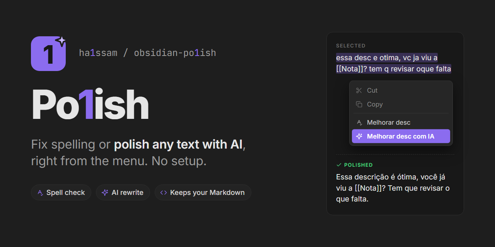

# Po1ish

Polish any text in Obsidian. Select it, right-click and pick one of two options:

- **Melhorar desc** fixes spelling with [LanguageTool](https://languagetool.org).
- **Melhorar desc com IA** also fixes grammar and makes the text read more clearly, without changing its meaning, tone or language. It catches what a spell checker misses, like "e ótimo" → "é ótimo" or "agente" → "a gente".

The selection is replaced with the corrected text. Press Ctrl+Z (Cmd+Z on Mac) to undo. The commands **Melhorar texto selecionado** and **Melhorar texto selecionado com IA** do the same from the command palette, so you can give them hotkeys in Settings → Hotkeys.

## AI engines

**Melhorar desc com IA** works with no setup. You can switch engines in the settings:

- **Plugin default** (no setup): the text goes through the plugin's server, which uses Google Gemini. Each person can make up to 6 requests per minute, and the daily free limit is shared by everyone using the plugin.
- **Your own Gemini key**: free, with daily limits that are only yours. Create a key at [aistudio.google.com/apikey](https://aistudio.google.com/apikey) and pick it in the plugin settings. The key is kept in Obsidian's Keychain, not in your notes.
- **Ollama**: runs on your own computer, so the text never leaves it. Install [Ollama](https://ollama.com), download a model (for example `ollama pull gemma3`) and pick it in the settings. Desktop only.

## What is left untouched

Markdown syntax is never "corrected": list and task markers, headings, quotes, bold and italic markers, `[[links]]`, `[text](url)` targets, URLs, `#tags`, inline and block code, LaTeX and HTML tags. The AI never sees them: they are swapped for placeholders and put back afterwards. If the AI drops or moves one, nothing is changed and you get a notice.

## Settings

- **Idioma**: the spell-check language. Portuguese (Brazil) by default; also Portuguese (Portugal), English, Spanish or automatic detection.
- **Servidor do LanguageTool**: the free public server is used by default (up to 20 requests per minute and 20,000 characters per request). Point it to your own LanguageTool server if you have one.
- **Motor**: the AI engine, as described above.

## Privacy

Only the selected text is sent: to the LanguageTool server for **Melhorar desc**, and to the AI engine you picked for **Melhorar desc com IA** (Google Gemini, directly or through the plugin's server, or your local Ollama). On Gemini's free plan, Google may use the text to improve its models. Nothing else from your vault is sent.

## Manual install

Download `main.js` and `manifest.json` from the [latest release](../../releases/latest) into `<your vault>/.obsidian/plugins/polish/`, then enable **Po1ish** in Settings → Community plugins. Requires Obsidian 1.11.4 or newer.

## Plugin server

The `worker/` folder is the Cloudflare Worker behind **Plugin default**. It keeps the Gemini key as a secret, only accepts text to revise (the prompt is fixed), limits each IP to 6 requests per minute, and falls back to another Gemini model when one is slow or busy.

```bash
cd worker
npm install
npx wrangler login
npx wrangler secret put GEMINI_KEY
npx wrangler deploy
```

Then set `SERVER_URL` in `src/ai.ts` to the Worker's address.

## Development

```bash
npm install
npm run dev     # rebuilds main.js on every change
npm run build   # type-check and production build
```
